# ISMS Database Guide

Everything the teacher needs to inspect the MongoDB database behind the
**Internship and Scholarship Management System**.

| Item | Value |
|---|---|
| Database | `isms_db` |
| Local connection string | `mongodb://127.0.0.1:27017/isms_db` |
| ODM | Mongoose 8 (`models/*.js`) |
| Collections | 11 |
| Seeded documents | ~35 users, 45 opportunities, 130+ applications |

---

## 1. Connecting the tools

### MongoDB Compass (GUI)

1. Start MongoDB (see [§7](#7-troubleshooting)).
2. Open **MongoDB Compass**.
3. Paste into the connection string field:
   ```
   mongodb://127.0.0.1:27017/isms_db
   ```
4. Click **Connect** → the `isms_db` database with all 11 collections appears in
   the left sidebar.

### mongosh (terminal)

```powershell
mongosh "mongodb://127.0.0.1:27017/isms_db"
```

---

## 2. Collection overview

| Collection | Documents (seeded) | Purpose |
|---|---:|---|
| `users` | 34 | All accounts (1 admin, 8 companies, 25 students) + auth data |
| `studentprofiles` | 25 | Student-only data: skills, education, CV, strength |
| `companyprofiles` | 8 | Company-only data: logo, industry, verification, rating |
| `opportunities` | 45 | Internship + scholarship posts (the core content) |
| `applications` | ~133 | Student submissions with a full status timeline |
| `notifications` | ~140 | In-app notifications (bell icon) |
| `bookmarks` | ~51 | Saved opportunities (unique per student) |
| `reviews` | ~34 | Student → company ratings (unique per pair) |
| `activitylogs` | ~320 | Audit trail of every important action |
| `feedbacks` | 6 | Public contact-form messages |
| `announcements` | 4 | Admin announcements shown on dashboards |

---

## 3. Relationship diagram

```mermaid
erDiagram
    USERS ||--o| STUDENTPROFILES : "has (role=student)"
    USERS ||--o| COMPANYPROFILES : "has (role=company)"
    USERS ||--o{ OPPORTUNITIES : "posts (company)"
    USERS ||--o{ APPLICATIONS : "submits (student)"
    USERS ||--o{ APPLICATIONS : "receives (company)"
    USERS ||--o{ NOTIFICATIONS : "gets"
    USERS ||--o{ ACTIVITYLOGS : "performs"
    USERS ||--o{ BOOKMARKS : "saves"
    USERS ||--o{ REVIEWS : "writes"
    USERS ||--o{ REVIEWS : "is rated"
    STUDENTPROFILES }o--|| USERS : "user -> ObjectId"
    COMPANYPROFILES }o--|| USERS : "user -> ObjectId"
    OPPORTUNITIES }o--|| USERS : "company -> ObjectId"
    OPPORTUNITIES }o--o| COMPANYPROFILES : "companyProfile -> ObjectId"
    APPLICATIONS }o--|| USERS : "student -> ObjectId"
    APPLICATIONS }o--|| USERS : "company -> ObjectId"
    APPLICATIONS }o--|| OPPORTUNITIES : "opportunity -> ObjectId"
    BOOKMARKS }o--|| USERS : "student -> ObjectId"
    BOOKMARKS }o--|| OPPORTUNITIES : "opportunity -> ObjectId"
    REVIEWS }o--|| USERS : "student -> ObjectId"
    REVIEWS }o--|| USERS : "company -> ObjectId"
    NOTIFICATIONS }o--|| USERS : "user -> ObjectId"
    ACTIVITYLOGS }o--o| USERS : "user -> ObjectId"

    USERS {
        ObjectId _id PK
        string name
        string email UK
        string password "bcrypt hash"
        string role "student|company|admin"
        string status "active|suspended|pending"
        boolean isEmailVerified
        date lastLogin
        date createdAt
        date updatedAt
    }
    STUDENTPROFILES {
        ObjectId _id PK
        ObjectId user FK "unique"
        string university
        string degree
        number cgpa
        array skills "name + level"
        string cvPath
        number profileStrength
    }
    COMPANYPROFILES {
        ObjectId _id PK
        ObjectId user FK "unique"
        string companyName
        string industry
        boolean verified
        number averageRating
    }
    OPPORTUNITIES {
        ObjectId _id PK
        ObjectId company FK
        ObjectId companyProfile FK
        string companyNameCopy "denormalised"
        string title
        string type "internship|scholarship"
        string status "pending|approved|rejected"
        date deadline
        array requiredSkills
        number views
        boolean isActive
    }
    APPLICATIONS {
        ObjectId _id PK
        ObjectId student FK
        ObjectId opportunity FK
        ObjectId company FK
        string status "submitted..withdrawn"
        array statusHistory
        string cvPath
    }
```



---

## 4. Field reference

### 4.1 `users`

| Field | Type | Notes |
|---|---|---|
| `_id` | ObjectId | primary key |
| `name` | String | required, ≤120 chars |
| `email` | String | **unique**, lowercased, regex-validated |
| `password` | String | bcrypt hash, `select: false` (never returned by default) |
| `role` | String | enum `student` / `company` / `admin`, indexed |
| `status` | String | enum `active` / `suspended` / `pending`, indexed |
| `isEmailVerified` | Boolean | default `false` |
| `lastLogin` | Date | |
| `avatar` | String | optional image path |
| `resetPasswordToken` | String | SHA-256 hash of the reset token |
| `resetPasswordExpires` | Date | reset link valid 1 hour |
| `createdAt` / `updatedAt` | Date | from `timestamps: true` |

Indexes: `email` (unique), `role`, `status`, `{role, status, createdAt:-1}`, text `{name, email}`.

### 4.2 `studentprofiles`

| Field | Type | Notes |
|---|---|---|
| `user` | ObjectId → User | **required, unique** (one profile per student) |
| `phone`, `address` | String | personal |
| `dateOfBirth` | Date | |
| `gender` | String | enum `male` / `female` / `other` / `prefer-not-to-say` |
| `university`, `department`, `degree` | String | academic |
| `currentSemester` | Number | 1–12 |
| `cgpa` | Number | 0–10 |
| `graduationYear` | Number | 1950–2100 |
| `skills[]` | Array | sub-docs `{ name, level }`, level = `beginner\|intermediate\|advanced\|expert` |
| `interests[]` | [String] | max 20 |
| `bio` | String | ≤1200 chars |
| `linkedin`, `github`, `portfolio` | String | |
| `cvPath` | String | filename inside `uploads/cv` (never a public URL) |
| `cvOriginalName`, `cvUploadedAt` | String / Date | |
| `documents[]` | Array | `{ title, path, originalName, size, mimeType, uploadedAt }` |
| `education[]` | Array | `{ institution, degree, fieldOfStudy, startYear, endYear, grade, description }` |
| `projects[]` | Array | `{ title, description, technologies[], link, startDate, endDate }` |
| `profileStrength` | Number | 0–100, recalculated by `utils/profileStrength.js` |

Indexes: `user` (unique), `{university, department}`, `{cgpa:-1}`, `{'skills.name':1}`.

### 4.3 `companyprofiles`

| Field | Type | Notes |
|---|---|---|
| `user` | ObjectId → User | **required, unique** |
| `companyName` | String | required, ≤160 |
| `industry`, `website`, `location` | String | |
| `size` | String | enum `1-10` … `1000+` |
| `description` | String | ≤3000 |
| `logo` | String | filename inside `uploads/logos` |
| `contactPerson`, `contactPhone` | String | |
| `verified` | Boolean | set by an admin (FR-23), indexed |
| `averageRating`, `reviewCount` | Number | cached from `reviews` |

Indexes: `user` (unique), text `{companyName, industry, description}`, `{verified:-1, createdAt:-1}`.

### 4.4 `opportunities`

| Field | Type | Notes |
|---|---|---|
| `company` | ObjectId → User | required (the company user) |
| `companyProfile` | ObjectId → CompanyProfile | |
| `companyNameCopy` | String | **denormalised company name** so the text index matches it |
| `title` | String | required, 5–180 |
| `type` | String | enum `internship` / `scholarship` |
| `description` | String | required, 30–8000 |
| `requirements` | String | ≤5000 |
| `location` | String | required |
| `mode` | String | enum `onsite` / `remote` / `hybrid` |
| `duration` | String | e.g. "3 months" |
| `stipend` | Number | monthly stipend (internship) or total award (scholarship) |
| `openings` | Number | ≥1 |
| `category` | String | used by the filter sidebar |
| `deadline` | Date | required — expiry is computed, never stored twice |
| `requiredSkills[]` | [String] | drives the recommendation engine |
| `minCgpa` | Number | 0–10 |
| `tags[]` | [String] | searchable keywords |
| `status` | String | enum `pending` / `approved` / `rejected` |
| `rejectionReason` | String | mandatory when `status = rejected` |
| `reviewedBy` | ObjectId → User | the admin who moderated it |
| `reviewedAt` | Date | |
| `views` | Number | incremented on every detail view |
| `isActive` | Boolean | company can close/reopen the post |

Virtuals (computed, never stored): `isExpired`, `daysLeft`, `isClosingSoon`,
`isVisibleToStudents`, `typeLabel`, `stipendLabel`.

Indexes: `opportunity_text_index` (text), `{status, isActive, deadline}`,
`{status, createdAt:-1}`, `{company, createdAt:-1}`, `{type, mode, category, deadline}`,
`{views:-1}`, `{stipend:1}`, plus single-field indexes.

### 4.5 `applications`

| Field | Type | Notes |
|---|---|---|
| `student` | ObjectId → User | required |
| `opportunity` | ObjectId → Opportunity | required (set to `null` if the post is deleted) |
| `company` | ObjectId → User | denormalised recipient |
| `coverLetter` | String | required, 20–5000 |
| `answers[]` | Array | `{ question, answer }` |
| `cvPath` / `cvOriginalName` / `cvSource` | String | `cvSource` = `profile` or `upload` |
| `documents[]` | Array | extra files sent with the application |
| `status` | String | enum `submitted, under_review, shortlisted, interview, accepted, rejected, withdrawn` |
| `companyNote` | String | last note written by the company |
| `statusHistory[]` | Array | `{ status, changedAt, changedBy, note }` — the timeline |
| `appliedAt` | Date | |

**Unique compound index `{student, opportunity}`** — the database itself blocks a
second application to the same post.

### 4.6 `notifications`

`user`, `title`, `message`, `type` (`application|status|moderation|account|announcement|review|system`),
`link`, `isRead`, `createdAt`. Index `{user, isRead, createdAt:-1}`.

### 4.7 `bookmarks`

`student`, `opportunity`, `createdAt`. **Unique `{student, opportunity}`** — the save
button is idempotent.

### 4.8 `reviews`

`student`, `company`, `companyProfile`, `rating` (1–5), `comment`. **Unique
`{student, company}`** — one review per student per company.

### 4.9 `activitylogs`

`user`, `userName` (denormalised so the log survives a deleted user), `userRole`,
`action`, `entity`, `entityId`, `ip`, `details`, `createdAt`.

### 4.10 `feedbacks`

`name`, `email`, `subject`, `message`, `status` (`new|seen|resolved`), `user`, `ip`.

### 4.11 `announcements`

`title`, `body`, `audience[]` (`student|company|admin`), `level`
(`info|success|warning|danger`), `isActive`, `createdBy`, `createdByName`, `expiresAt`.

---

## 5. Data-integrity rules (implemented in the code)

| Rule | Where it is enforced |
|---|---|
| One application per student per opportunity | unique index + `services/applicationService.js` |
| Students only see `approved` + `isActive` + not expired | `utils/opportunityQuery.js` (single source of truth) |
| Applications blocked after the deadline | `services/applicationService.js` → `createApplication` |
| Only approved posts accept new applications | same |
| Rejecting a post requires a reason | `services/moderationService.js` → `reject()` throws without one |
| Editing an approved post re-queues it for moderation | `controllers/companyController.js` → `updateOpportunity` |
| The last active admin cannot be demoted, suspended or deleted | `controllers/adminController.js` + `protectedAdminIds()` |
| Suspended users cannot sign in | `controllers/authController.js` + `middleware/auth.js` |
| Deleting a user removes their linked records | `controllers/adminController.js` → `updateUser` / `bulkUserAction` |
| Deleting an opportunity detaches its applications | `controllers/companyController.js` → `deleteOpportunity` |
| Passwords / tokens are never logged | `utils/logActivity.js`, `utils/mailer.js` |

---

## 6. Ready-to-paste mongosh queries

> Open `mongosh "mongodb://127.0.0.1:27017/isms_db"` and paste any block below.

### 6.1 Sanity check — collections and counts

```javascript
db.getCollectionNames().sort().forEach(c =>
  print(c.padEnd(20), db.getCollection(c).countDocuments())
);
```

### 6.2 All accounts with their role (never returns the password hash)

```javascript
db.users.find({}, { password: 0, resetPasswordToken: 0, resetPasswordExpires: 0 })
  .sort({ role: 1, createdAt: -1 })
  .forEach(u => print(u.role.padEnd(8), u.status.padEnd(10), u.email));
```

### 6.3 Students ordered by CGPA (for the "best applicants" demo)

```javascript
db.studentprofiles.aggregate([
  { $lookup: { from: "users", localField: "user", foreignField: "_id", as: "u" } },
  { $unwind: "$u" },
  { $project: { _id: 0, name: "$u.name", email: "$u.email", university: 1, cgpa: 1,
                skills: { $map: { input: "$skills", in: "$$this.name" } } } },
  { $sort: { cgpa: -1 } },
  { $limit: 10 }
]).forEach(printjson);
```

### 6.4 Opportunities that students can currently see

```javascript
db.opportunities.find({
  status: "approved",
  isActive: true,
  deadline: { $gt: new Date() }
})
  .sort({ deadline: 1 })
  .select("title type companyNameCopy location deadline stipend openings views")
  .forEach(o => print(o.type.padEnd(12), o.companyNameCopy.padEnd(24), o.title));
```

### 6.5 Pending moderation queue (the admin dashboard)

```javascript
db.opportunities.find({ status: "pending" })
  .sort({ createdAt: 1 })
  .select("title type companyNameCopy createdAt")
  .forEach(o => print(o.companyNameCopy.padEnd(24), o.type.padEnd(12), o.title));
```

### 6.6 Keyword search using the text index (FR-05)

```javascript
db.opportunities.find(
  { $text: { $search: "react" } },
  { score: { $meta: "textScore" }, title: 1, companyNameCopy: 1, _id: 0 }
).sort({ score: { $meta: "textScore" } }).forEach(printjson);
```

### 6.7 Faceted search — remote internships closing within 7 days

```javascript
db.opportunities.find({
  status: "approved", isActive: true,
  type: "internship", mode: "remote",
  deadline: { $gt: new Date(), $lt: new Date(Date.now() + 7 * 24 * 3600 * 1000) }
}).select("title companyNameCopy deadline").forEach(printjson);
```

### 6.8 Top 10 most required skills across approved posts

```javascript
db.opportunities.aggregate([
  { $match: { status: "approved" } },
  { $unwind: "$requiredSkills" },
  { $group: { _id: "$requiredSkills", posts: { $sum: 1 } } },
  { $sort: { posts: -1 } },
  { $limit: 10 },
  { $project: { _id: 1, posts: 1 } }
]).forEach(printjson);
```

### 6.9 Applications per status (aggregation used by both dashboards)

```javascript
db.applications.aggregate([
  { $group: { _id: "$status", count: { $sum: 1 } } },
  { $sort: { count: -1 } }
]).forEach(printjson);
```

### 6.10 Monthly application trend (last 6 months)

```javascript
db.applications.aggregate([
  { $match: { appliedAt: { $gte: new Date(Date.now() - 180 * 24 * 3600 * 1000) } } },
  { $group: { _id: { $dateToString: { format: "%Y-%m", date: "$appliedAt" } }, count: { $sum: 1 } } },
  { $sort: { _id: 1 } }
]).forEach(printjson);
```

### 6.11 Applicants for one opportunity, with their CGPA

```javascript
db.applications.aggregate([
  { $match: { opportunity: ObjectId("<opportunityId>") } },
  { $lookup: { from: "studentprofiles", localField: "student", foreignField: "user", as: "profile" } },
  { $unwind: "$profile" },
  { $lookup: { from: "users", localField: "student", foreignField: "_id", as: "u" } },
  { $unwind: "$u" },
  { $project: { _id: 0, student: "$u.name", email: "$u.email",
                cgpa: "$profile.cgpa", status: 1, appliedAt: 1 } },
  { $sort: { cgpa: -1 } }
]).forEach(printjson);
```

### 6.12 Most viewed opportunities (bonus feature 14)

```javascript
db.opportunities.find({ status: "approved" })
  .sort({ views: -1 }).limit(10)
  .select("title companyNameCopy views").forEach(printjson);
```

### 6.13 Approval rate (moderation dashboard)

```javascript
const total = db.opportunities.countDocuments({});
const ok = db.opportunities.countDocuments({ status: "approved" });
print("total:", total, "approved:", ok, "approval rate:", Math.round((ok / total) * 100) + "%");
```

### 6.14 Verify the integrity rules hold in the seeded data

```javascript
// a) no duplicate applications
db.applications.aggregate([
  { $group: { _id: { s: "$student", o: "$opportunity" }, n: { $sum: 1 } } },
  { $match: { n: { $gt: 1 } } }
]).forEach(printjson);   // expect: no output

// b) no student ever applied to a non-approved / expired post
db.applications.aggregate([
  { $lookup: { from: "opportunities", localField: "opportunity", foreignField: "_id", as: "o" } },
  { $unwind: "$o" },
  { $match: { $or: [ { "o.status": { $ne: "approved" } }, { "o.isActive": false },
                     { "o.deadline": { $lt: new Date() } } ] } },
  { $project: { _id: 0, opportunity: 1, oppStatus: "$o.status" } }
]).forEach(printjson);   // expect: no output

// c) every application has a status history
print("without history:", db.apportunities.countDocuments({ statusHistory: { $size: 0 } }));

// d) no duplicate bookmarks / reviews
print("dup bookmarks:", db.bookmarks.aggregate([
  { $group: { _id: "$student", ids: { $addToSet: "$opportunity" } } },
  { $match: { $expr: { $gt: [{ $size: "$ids" }, { $size: { $setDifference: ["$ids", "$ids"] } }] } } }
]).itcount());
```

### 6.15 Activity log for one user

```javascript
db.activitylogs.find({ user: ObjectId("<userId>") })
  .sort({ createdAt: -1 }).limit(20)
  .select("action entity details ip createdAt").forEach(printjson);
```

### 6.16 Every index on `opportunities` (to show in Compass → Indexes tab)

```javascript
db.opportunities.getIndexes().forEach(i =>
  print(i.name.padEnd(32), JSON.stringify(i.key))
);
```

---

## 7. Troubleshooting

**"MongoDB is NOT reachable" when starting the server**

```powershell
# PowerShell (Administrator) - start the Windows service
net start MongoDB

# check the exact service name
Get-Service MongoDB*

# if the service does not exist, run mongod manually:
& "C:\Program Files\MongoDB\Server\7.0\bin\mongod.exe" --dbpath "C:\data\db"
```

**Compass cannot connect**

* MongoDB service not running → `net start MongoDB`
* Windows Firewall blocking port 27017 → allow `mongod.exe` (private networks only)
* Wrong port → `Get-NetTCPConnection -LocalPort 27017`

**The seed says "database is empty"**

`npm run seed` must finish *before* the first page load; it prints a summary
table with the exact counts.

---

## 8. Aggregations implemented in the application

The dashboards do not count documents in JavaScript — every number comes from a
MongoDB aggregation pipeline (`services/dashboardService.js`):

| # | Aggregation | Used by |
|---|---|---|
| 1 | applications grouped by status | student + company dashboards |
| 2 | applications per month (`$dateToString`) | student + admin dashboards |
| 3 | users grouped by role / status | admin dashboard |
| 4 | users per month (growth) | admin analytics |
| 5 | opportunities grouped by type | admin dashboard |
| 6 | opportunities grouped by category | admin analytics |
| 7 | opportunities grouped by status → **approval rate** | admin dashboard |
| 8 | top required skills (`$unwind` + `$group` + `$sort`) | admin analytics |
| 9 | applicants per status for one opportunity | company applicants page |
| 10 | applicants per opportunity (`$lookup`) | company dashboard |
| 11 | openings per category (`$sum`) | admin analytics |
| 12 | top companies / most viewed / site counters | landing page |